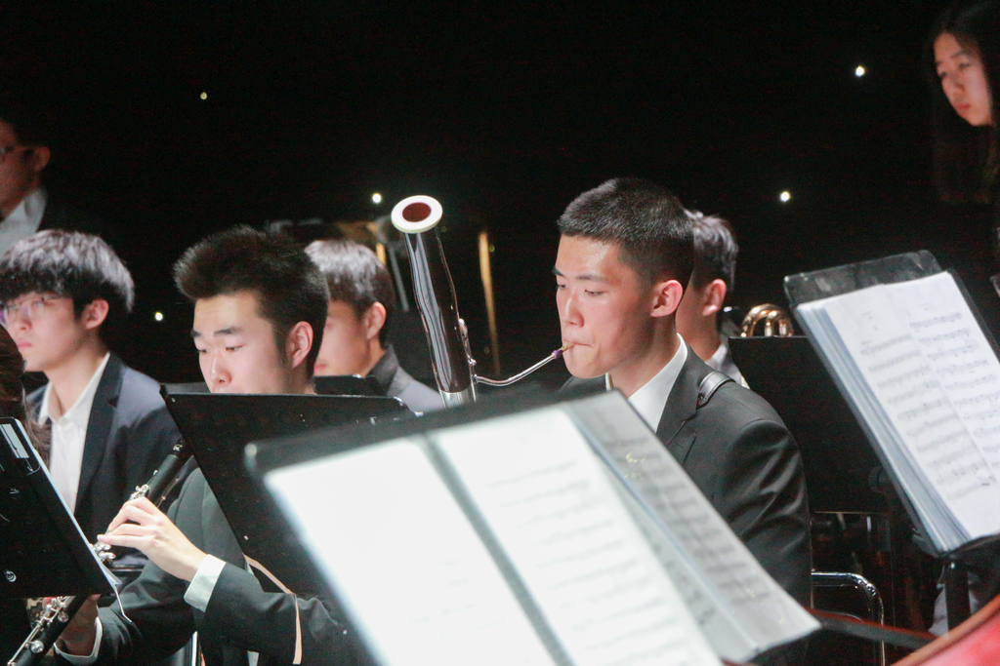
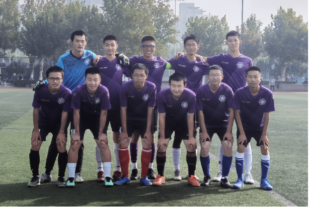
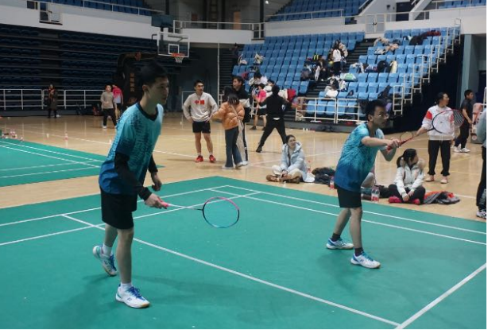








# 👋 About Me
I'm a senior undergraduate student at [Weixian College](https://www.wxc.tsinghua.edu.cn/) and [School of Biomedical Engineering, Tsinghua University](https://www.med.tsinghua.edu.cn/en/).

I am currently working as a research assistant at [Birth Lab](https://birthlab.github.io/), Tsinghua University and I'm fortunate to be advised by [Prof. Qiyuan Tian](https://www.med.tsinghua.edu.cn/info/1143/2126.htm). We are striving to explore the frontiers of AI in Medicine.

I also have great memories working at [The Multi-Scale Robotics Lab, ETH Zurich](https://msrl.ethz.ch/), advised by [Prof. Bradley Nelson](https://msrl.ethz.ch/the-lab/team/Brad_Nelson.html). This summer I joined [Subtle Medical Inc.](https://subtlemedical.com/) as a research intern, developing human-in-the-loop deep learning algorithms for medical imaging.

My current research interests include Agentic Systems and Trustworthy AI. I am always passionate about interdisciplinary collaboration, so please feel free to reach out!

# 🔥 News
**2026.02.04:** 🎉 Four abstracts accepted by [ISMRM 2026](https://www.ismrm.org/26m/), with an Educational Stipend awarded!

**2025.10.27:** 🎉 Received the **Outstanding Poster Award** at the Tsinghua University Initiative Scientific Research Program Symposium.

**2025.10.17:** 🎖 Awarded the **National Scholarship** (*Top 0.2%*) for the second consecutive year!

**2025.09.27:** 🏆 Our team won the **1st Place** in the [MICCAI 2025 autoPET IV Challenge](https://autopet-iv.grand-challenge.org/autopet-iv/) (Task I)! 🎉🎉 Thrilled to receive this award and present our method on the workshop!

  

**2025.07.22:** 🎉🎉 Our team won [the 1st prize](https://img.erpweb.eu.org/imgs/2025/07/126d96158b08e1d8.jpg) at the 10th National Biomedical Engineering Innovation Design Competition for College Students (Top 5%).

**2025.07.20:** Attended the [Medical Imaging Computing Seminar (MICS) 2025](http://mics2025.com/) in Cixi, Zhejiang. [Photo](https://drive.google.com/file/d/1MvW5ANSwRB1bYXC676vW0CCNSEsbHuGD/view?usp=sharing)

**2025.06.23:** Began my summer internship at [Subtle Medical Inc.](https://subtlemedical.com/).

**2025.02.17:** Delighted to join the [Lab for Brain Imaging Research at Tsinghua, BIRTH](https://birthlab.github.io/).

**2024.09.16:** Honored to join the [Multi-Scale Robotics Lab](https://msrl.ethz.ch/) at ETH Zurich to develop biomedical micro-robots.

**2024.09.11:** Arrived at Zurich! Excited to begin my exchange study journey in Switzerland.

# 📝 Publications 
* equal contribution | &dagger; corresponding author   

<h2 id="CONFERENCE PAPERS" style="color: #2c4a88; padding-top: 60px; margin-top: -60px; margin-bottom: 8px;">CONFERENCE PAPERS</h2>

<ol reversed>
  <li id="MA-Pub1"> 
    Multi-Organ Volumetric Growth Trajectories in Fetuses with Hydronephrosis   
    Junwei Huang, Kasidit Anmahapong, Haoxiang Li, Mingxuan Liu, Juncheng Zhu, Hongjia Yang, Yijin Li, Yingqi Hao, Fenglin Jia, Yi Liao, Haibo Qu, Qiyuan Tian&dagger;  
    <i> ISMRM & ISMRT Annual Meeting & Exhibition <strong>(ISMRM)</strong></i>, 2026. (Digital Poster)
  </li>

  <li id="MA-Pub0"> 
    autoPET IV challenge: Incorporating organ supervision and human guidance for lesion segmentation in PET/CT  
    <a href="https://arxiv.org/pdf/2509.02402">[Paper]</a> <a href="https://github.com/huang-jw22/autoPET-4-submission/tree/master">[Code]</a>  
    Junwei Huang, Yingqi Hao, Yitong Luo, Ziyu Wang, Mingxuan Liu, Yifei Chen, Yuanhan Wang, Lei Xiang, Qiyuan Tian&dagger;  
    <i> MICCAI autoPET IV challenge <strong>(MICCAI), </strong></i> 2025. (Task I Winner Solution)
  </li>
</ol>

<h2 id="PREPRINTS" style="color: #2c4a88; padding-top: 60px; margin-top: -60px; margin-bottom: 8px;">PREPRINTS</h2>

<ol reversed>
  <li id="MA-Pre1"> 
    FetalAgents: A Multi-Agent System for Fetal Ultrasound Image and Video Analysis   
    <a href="https://arxiv.org/pdf/2603.09733">[arXiv]</a> <a href="https://github.com/huang-jw22/FetalAgents/tree/main">[Code]</a>  
    Xiaotian Hu<b>*</b>, Junwei Huang*, Mingxuan Liu<b>*</b>, Kasidit Anmahapong, Yifei Chen, Yitong Luo, Yiming Huang, Xuguang Bai, Zihan Li, Yi Liao, Haibo Qu, Qiyuan Tian<b>&dagger;</b>  
    <i>arXiv preprint</i>, 2026. (Under review)
  </li>
</ol>

# 🎖 Honors and Awards
- *2025, 2024* **National Scholarship** (Twice)   &nbsp; &nbsp; &nbsp; *Top scholarship in China. 0.2% nationwide*.
- *2025, 2024, 2023* **Tsinghua University Comprehensive Excellence Scholarship (Top 10%)**
- *2025* **MICCAI autoPET IV Challenge 1st Place Winner (Task I)**
- *2025* **First Prize** at the 10th National Biomedical Engineering Innovation Design Competition for College Students **(Top 5%)**
- *2025* **Outstanding Poster Award** at the Tsinghua University Initiative Scientific Research Program Symposium
- *2024* **First Prize** at the 7th National College Student Art Exhibition (Instrumental Music Category)
- *2024* **Outstanding Scholarship**, Fujian Province Youth Talent Development Program
- *2024* **College Contribution Scholarship**, Weixian College, Tsinghua University

# 📖 Education
- *2024.09 - 2025.02*, Exchange student: **Department of Information Technology and Electrical Engineering**, ETH Zurich, Switzerland. 
- *2022.09 – present*, Undergraduate student: **Weixian College** and **School of Biomedical Engineering**, Tsinghua University, China.

# 🎬 Hobbies
When I’m not immersed in coursework and research, I love diving into arts, literature, and sports. 

- Classical Music: I have a keen interest in classical music, both as a listener and a player. I have been playing the piano and saxophone since 6. At 12 I joined our junior high school orchestra, and have been playing Bassoon ever since. Entering University, I joined the **Tsinghua University Symphonic Orchestra**, where I’ve had the pleasure of performing in several concerts and competitions.
  

  

- Sports: I have a diverse passion for sports, including but not limited to soccer, tennis, badminton, and snooker. I am part of the College Soccer & Badminton team, as well as a member of the University Soccer Referee Association. Beyond competitive sports, I also enjoy hiking — being in the mountains always makes me feel closer to the world and to my soul.

  
  

- Films & Literature: In one of my favorite film *[Yi Yi](https://letterboxd.com/film/yi-yi/)*, there is a line: *"We live three times as long since man invented movies."* That's exactly why I love them: Through the screens and book pages, we get to experience lives that we would never be able to experience in reality. 

  

# 🔗 LINKS
BIRTHLab: [The lab for Brain Imaging Research at Tsinghua](https://birthlab.github.io/) Mingxuan Liu: [School of Biomedical Engineering, Tsinghua University](https://arktis2022.github.io/) Haoxiang Li: [School of Biomedical Engineering, Tsinghua University](https://lihaoxiang-20.github.io/) Yifei Chen: [School of Biomedical Engineering, Tsinghua University](https://justlfc03.github.io/)  Yingqi Hao: [School of Biomedical Engineering, Tsinghua University](https://yingqihao2022.github.io/) Jialan Zheng: [School of Biomedical Engineering, Tsinghua University](https://zjl21.github.io/) Xuguang Bai: [School of Biomedical Engineering, Tsinghua University](https://jasonw375.github.io/)  Yijin Li: [School of Biological Science and Medical Engineering, Beihang University](https://liyijin6815.github.io/)

